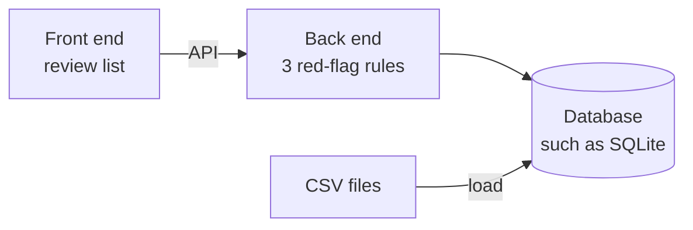

# Kuwait GitHub Copilot Hackathon - Nov 2026

    

🎯 **Your mission:** help a compliance analyst spot suspicious transactions in seconds, and explain every flag.

> [!IMPORTANT]
> Synthetic data only. Never bring real customer data, credentials or production systems into this repo.

## 💼 The business problem

**The problem:** a bank's compliance analyst must review a month of transactions but can't quickly see which ones look suspicious or why, so real risks slip through and flags can't be explained to auditors.

**Why it matters:** banks must report suspicious activity to the authorities. A missed case can mean regulatory fines and damage to the bank's reputation, and a flag without a reason wastes investigators' time.

## 🧰 What you'll build

You get one month of the bank's transactions. Your app checks every transaction for three red flags and gives the analyst a review list: the transactions that need a closer look, and why.



Build it in three parts: a database, a back end that runs the rules and serves the results through an API, and a front end that gets everything it shows from that API.

**The data**

| File | Rows | What it represents |
|---|---:|---|
| [`transactions.csv`](data/transactions.csv) | 3,079 | Every payment in October 2026: the account (`account_id`), when it happened (`timestamp`), the amount in Kuwaiti dinars (`amount_kwd`) and the other party's country (`counterparty_country`) |
| [`accounts.csv`](data/accounts.csv) | 150 | Who owns each account and their customer segment, to show next to a flag |
| [`high_risk_countries.csv`](data/high_risk_countries.csv) | 4 | The countries the compliance team treats as high-risk |

All data is synthetic. The codes `XA` to `XD` are fictional countries, so no real country is labelled high-risk. The [data dictionary](data/README.md) explains every column and the data-quality issues.

**The red flags**

| The analyst asks | Rule ID | How to check it in the data | Suggested default |
|---|---|---|---|
| Is this amount unusually large? | `LARGE_AMOUNT` | Compare `amount_kwd` with the limit. | 3,000.000 KWD or more |
| Is this account suddenly very busy? | `VELOCITY` | Count transactions on the same `account_id` that are close together in `timestamp`. | 5 or more within 60 minutes |
| Is the money going to or coming from a high-risk country? | `HIGH_RISK_COUNTRY` | Look up `counterparty_country` in `high_risk_countries.csv`. | The country is on the list |

The defaults are a starting point. You can change them if you record the change in your plan and test it. Keep limits in configuration, not in code.

Decide these in your plan and cover them with tests:

- **Explainability:** what the analyst sees for each flag, for example `VELOCITY: 6 transactions in 38 min (limit: 5 in 60 min)`.
- **More than one red flag:** a transaction can raise several. Show all of them.
- **Bursts:** which transactions in a burst get the `VELOCITY` flag.
- **Boundaries:** test values exactly at the limits, such as 3,000.000 KWD and a gap of exactly 60 minutes.
- **Messy data:** the data has deliberate quality issues. See [Things to know](data/README.md#things-to-know).

**What the analyst sees:** the flagged transactions, each with every red flag it raised and the values behind it, plus a count per red flag.

### Deliverables

Every challenge has the same five deliverables, sized for a team of 5–8 in 1.5–2 hours.

- [ ] **Database:** load the three files into a database, for example SQLite, and handle the issues in [Things to know](data/README.md#things-to-know).
- [ ] **Back end:** the three red flags, with their limits in configuration, not in code.
- [ ] **API:** endpoints that return the flagged transactions, each with the rule that fired and the actual values, and a count per rule.
- [ ] **Front end:** a dashboard that shows the review list from the API, with a count per rule and filters for rule and account.
- [ ] **Tests:** automated tests for each rule and each endpoint, including values exactly at the limits and the data-quality cases.

The [Copilot starter kit](#-your-copilot-starter-kit) has a skill for the database, `/data-import`, and one for the API, `/api-endpoint`.

Use any language, framework and database, as long as it runs locally from your README. SQLite is a good default: it's a single file and needs no server. No machine learning is needed: plain business rules only.

## 🚀 Start here

1. Choose a team name.
2. Select **Use this template** > **Create a new repository** to create your team's copy, and include your team name in the repository name. Make it public, or give your trainer access.
3. Clone it and open it in your IDE with GitHub Copilot Chat.
4. Read this brief and the [data dictionary](data/README.md).
5. **Before you build**, plan with Copilot Plan mode and estimate your AI Credits per phase in [docs/ai-credit-budget.md](docs/ai-credit-budget.md).
6. Fill in the TODOs in [`.github/copilot-instructions.md`](.github/copilot-instructions.md) with your stack and conventions, and look through the rest of the [Copilot starter kit](#-your-copilot-starter-kit).
7. Build, test, review and document with Copilot. Commit often: your commit history is evidence.
8. Before your demo, complete [Your solution](#-your-solution) at the end of this README.

## 🧩 Your Copilot starter kit

Your repo comes with a starter kit in `.github/` that customizes Copilot for this project. Use it, change it and add to it.

| File | What it is | How to use it |
|---|---|---|
| [`.github/copilot-instructions.md`](.github/copilot-instructions.md) | Instructions: your stack and conventions. Copilot adds them to every request. | Replace the TODOs before you build. |
| [`.github/agents/reviewer.agent.md`](.github/agents/reviewer.agent.md) | Custom agent: reviews your code but can't edit it. | Select **Reviewer** from the **Agent** dropdown in Copilot Chat. |
| [`.github/skills/data-import/`](.github/skills/data-import/SKILL.md) | Skill: loads the files in `data/` into your database. It's unfinished on purpose: the first run writes a data profiler in your language. | Type `/data-import`, or ask Copilot to load the data. |
| [`.github/skills/api-endpoint/`](.github/skills/api-endpoint/SKILL.md) | Skill: adds API endpoints that follow your conventions, starting with the contract. | Type `/api-endpoint`, or ask Copilot to add an endpoint. |

Add your own skills for tasks you repeat, such as writing tests: your trainer looks for skills you wrote. The [Copilot customization guide](docs/copilot-customization.md) explains how the parts work together and how to make your own.

## 📅 The day at a glance

The day has two goals:

1. Use GitHub Copilot's Plan mode, agent mode, instructions, skills and chat review.
2. Build the habit of planning AI Credit consumption before you start prompting.

| | |
|---|---|
| **Team** | 5–8 developers |
| **Build time** | 1.5–2 hours |
| **Usage checkpoints** | Your trainer records each team member's AI Credit usage at the start of the build, at the mid-point check and at the end. |
| **Demo** | 5 minutes, then Q&A |
| **Scoring** | 100 points. See the [scoring rubric](#-scoring-rubric). |

## 🤖 Copilot focus for this challenge

Every team should use the practices the rubric scores: Plan mode, agent mode, a `.github/copilot-instructions.md` file with your team's conventions, reusable skills and Copilot Chat review. This challenge puts extra weight on three of them:

| Practice | How to apply it here |
|---|---|
| **Plan mode for rule design** | Turn the rules into a plan with acceptance criteria and edge cases for each rule, and a model choice and AI Credit budget for each phase. Save it as `docs/plan.md`. |
| **Agent-generated tests** | Have agent mode write tests for each rule, including boundaries and data-quality cases. Save the test prompt as a skill in `.github/skills/`. |
| **Copilot Chat review** | Ask Copilot Chat to review the rules engine for bugs and missed edge cases. Fix the findings and note what it caught. |

<details>
<summary>Example prompts</summary>

**Plan mode**

```text
Read README.md and data/README.md. Plan the database, a back end with an API for the three
rules and a front end for the review list. For each rule, list acceptance criteria and edge
cases. For each phase, recommend a model tier and estimate the AI Credits it will use.
```

**Tests** (for example, saved as `.github/skills/rule-tests/SKILL.md`)

```text
Write unit tests for the rule in the current file. Cover the normal case, the boundary
values and the data-quality issues described in data/README.md. Follow our test conventions.
```

**Review** (select the Reviewer agent first)

```text
Review the rules engine for bugs, unhandled edge cases and unclear flag reasons.
List the findings by severity. Don't change any code yet.
```

</details>

## 💳 AI Credit budget

Estimate AI Credits per phase before you build, then track what you actually use in [docs/ai-credit-budget.md](docs/ai-credit-budget.md). The example below is from the kickoff and assumes a team of 5–8 (950 credits is about USD 9.50). Make your own estimate: the point is the habit of estimating, not hitting an exact number.

| Phase | Copilot feature | Model tier | Budget (AI Credits) |
|---|---|---|---:|
| Plan | Plan mode / Ask | Frontier | 150 |
| Scaffold | Agent mode + instructions file | Low-cost | 100 |
| Build features | Agent / Edit mode | Mixed | 500 |
| Tests + review | Skill for tests, chat review | Low-cost | 150 |
| Docs + demo | Ask, README generation | Low-cost | 50 |
| **Total** | | | **950** |

Tips to spend smart:

- Match the model to the task. Save frontier models for planning and tricky logic, and use low-cost models for scaffolding, tests and docs.
- Keep context scoped. Attach only the files Copilot needs.
- Turn prompts you repeat into skills. Copilot reads only a skill's name and description until it needs the rest.

## 🏆 Scoring rubric

The rubric awards 100 points across the lifecycle. It's the same for every challenge, so winners are comparable.

| Stage | Points |
|---|---:|
| Plan | 15 |
| Build & quality with Copilot | 40 |
| Token efficiency | 25 |
| Impact & demo | 20 |
| **Total** | **100** |

### How scoring works

- Your trainer picks one level per stage: **Solid**, **Strong** or **Outstanding**. Each level is worth the points shown.
- Your score is the sum of the four stage scores. A stage with no evidence scores 0.
- Build & quality plus Token efficiency carry 65 points: they're the two goals of the day.
- Your trainer scores from evidence, not claims: your repo, budget sheet and demo, and the usage readings they recorded.
- Tie-break: the team with the higher Token efficiency score wins.
- Solid is the expected baseline. Most teams should reach Strong in 1.5–2 hours. Outstanding should stand out.

### Levels

| Stage | Solid | Strong | Outstanding |
|---|---|---|---|
| **Plan**<br>15 points | **5 pts**<br>Plan written with Copilot Plan mode; credit budget estimated per phase. | **10 pts**<br>Plan has acceptance criteria and a model choice per phase, with the reasoning explained. | **15 pts**<br>Plan drove the build, and the team re-planned at the mid-point check using actual usage. |
| **Build & quality with Copilot**<br>40 points | **16 pts**<br>Agent mode built the main features; `copilot-instructions.md` sets team conventions; runs end to end with tests on the core logic. | **28 pts**<br>Adds reusable skills for repeat tasks (tests, docs); edge cases tested; Copilot asked in chat to review the code and findings fixed. | **40 pts**<br>Copilot used across the whole loop (plan, build, test, review, docs); team shows where it saved the most time and where they had to correct it; another team could run it from the README. |
| **Token efficiency**<br>25 points | **10 pts**<br>Usage tracked; actual within ±30% of budget. | **18 pts**<br>Within ±15% of budget; models matched to tasks; context kept scoped. | **25 pts**<br>A concrete before/after where a prompt, context or model change cut credits without hurting the output. |
| **Impact & demo**<br>20 points | **8 pts**<br>Clear user and problem; working demo in 5 minutes. | **14 pts**<br>Rules or workflow are realistic for the business; Q&A handled well. | **20 pts**<br>Credible path to a real pilot; your trainer can picture it being used. |

### What your trainer looks at

| Stage | Evidence |
|---|---|
| Plan | `docs/plan.md` from Plan mode, and the budget and mid-point re-plan in `docs/ai-credit-budget.md` |
| Build & quality | `.github/copilot-instructions.md`, `.github/skills/`, tests, commit history and this README |
| Token efficiency | Budget versus actual usage in `docs/ai-credit-budget.md`, checked against your trainer's readings, and your before/after example |
| Impact & demo | Your 5-minute demo and Q&A |

### Clarifications

- **Token efficiency isn't about using the fewest credits.** It's scored against your own budget plus proof of optimization, so a team that barely used Copilot can't win it by spending little. Your trainer rewards value delivered per credit. The ±30% and ±15% bands apply to overspending and underspending.
- **IDE features are enough.** Every level can be reached with Copilot Chat features in the IDE: Plan mode, agent mode, instructions, skills and chat review. Skills need VS Code, Visual Studio or a JetBrains IDE.

## ✅ Your solution

> [!NOTE]
> Complete this section before your demo. Your trainer, and other teams, will run your app from it.

- **Team name:**
- **Team members:**
- **Stack:**

### Run it

```bash
# Replace with the exact steps to install and run your app.
```

### Test it

```bash
# Replace with the exact command that runs your tests.
```

### Rule-to-test traceability

| Rule | Implemented in | Tested in |
|---|---|---|
| `LARGE_AMOUNT` | | |
| `VELOCITY` | | |
| `HIGH_RISK_COUNTRY` | | |

### Copilot retrospective

- **Where Copilot saved us the most time:**
- **Where we had to correct it:**

### Evidence checklist

- [ ] Plan: `docs/plan.md`
- [ ] Budget, usage readings, mid-point re-plan and before/after example: [`docs/ai-credit-budget.md`](docs/ai-credit-budget.md)
- [ ] Team conventions: `.github/copilot-instructions.md`
- [ ] Skills you wrote: `.github/skills/`
